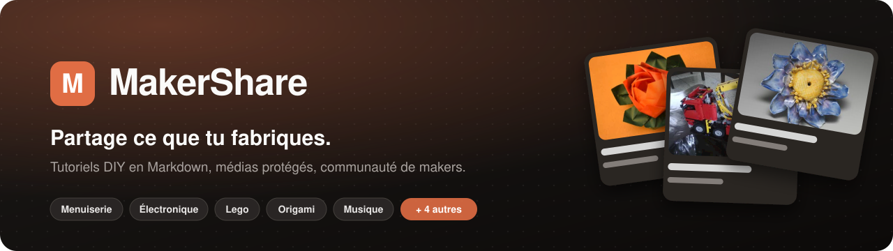
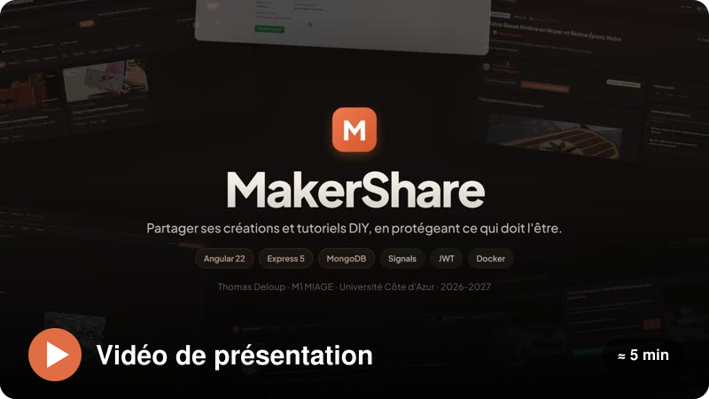
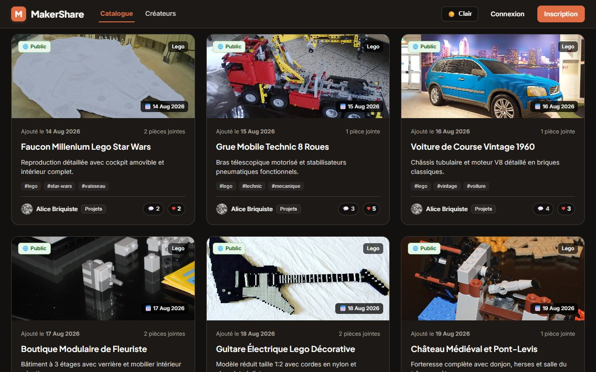
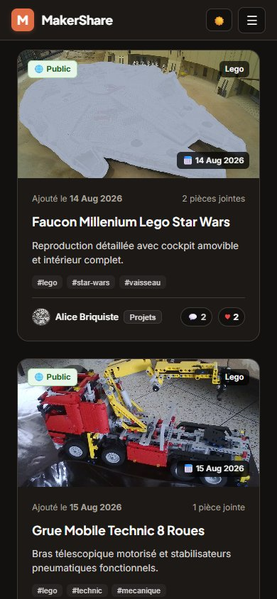
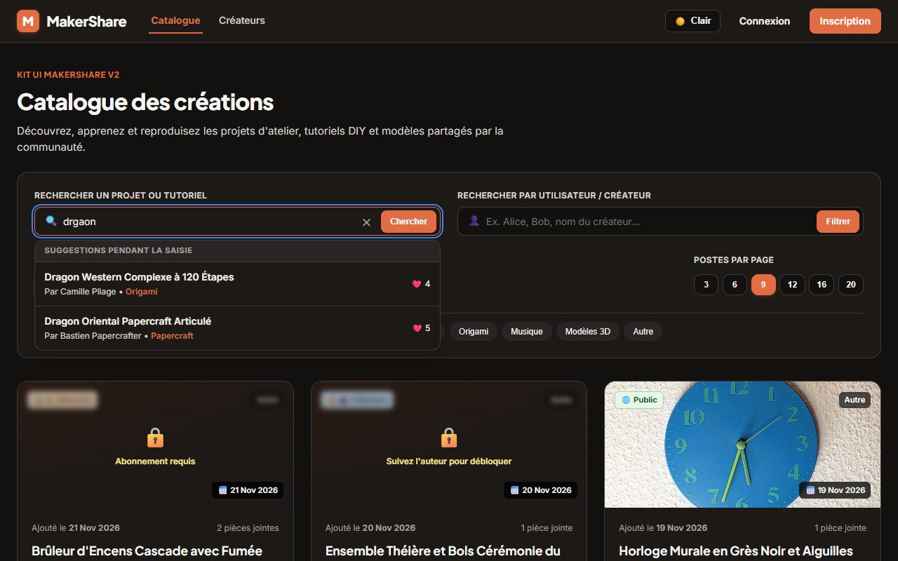
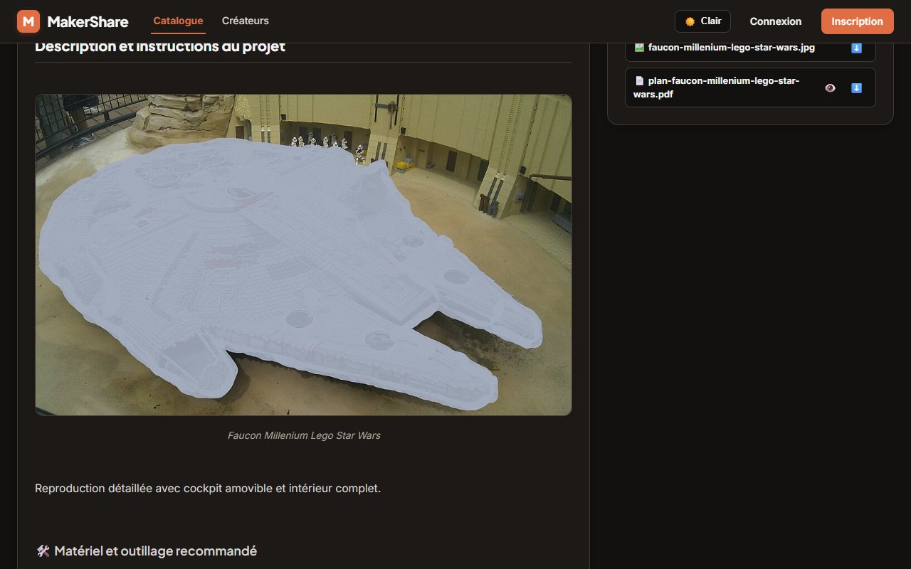
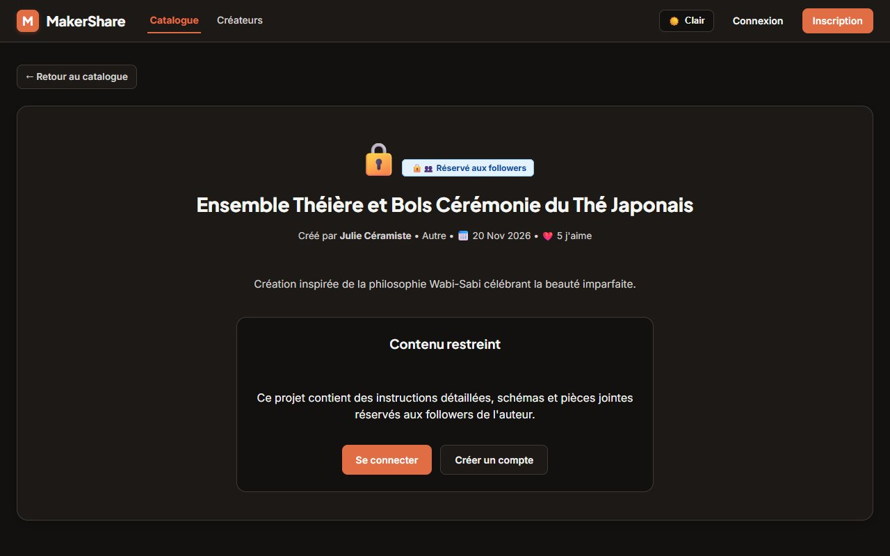
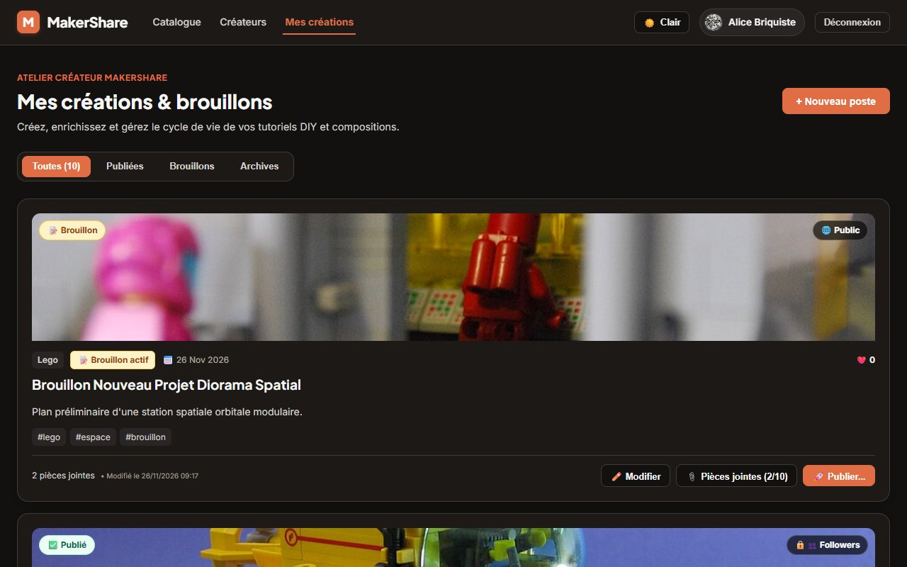

<p align="center">
  
</p>

<p align="center">
  <a href="https://github.com/xKayato/AngularM1_Miage_2026_2027_TP123/releases/tag/v5.0.0"></a>
  
  
  
  
  
  
</p>

<p align="center">
  <b>Plateforme de partage de tutoriels DIY</b> : menuiserie, électronique, Lego, origami, musique, impression 3D…<br>
  Projet libre des TP4 à TP6 · Master 1 MIAGE · Université Côte d'Azur · 2026–2027
</p>

<p align="center">
  <a href="#-essayer-en-2-minutes"><b>Essayer</b></a> ·
  <a href="#-vidéos"><b>Vidéos</b></a> ·
  <a href="#-aperçu"><b>Aperçu</b></a> ·
  <a href="docs/POINTS_FORTS.md"><b>Points forts techniques</b></a> ·
  <a href="API_CONTRACT.md"><b>API</b></a>
</p>

---

MakerShare permet de publier des tutoriels en Markdown avec photos, plans PDF et extraits audio, puis de **choisir qui peut les lire** : tout le monde, les followers, les abonnés, ou les seules personnes qui ont un lien secret. On y suit des créateurs, on s'abonne à leurs contenus exclusifs, on like et on commente. Le projet est né de *Guitar Practice Cloud* (TP1 à TP3), dont toute l'API continue de fonctionner.

## 🎬 Vidéos

**Publicité** — MakerShare en 30 secondes

https://github.com/user-attachments/assets/da447e78-1821-477e-822f-c43a050700b4

**Présentation** — le projet en 5 minutes

<a href="https://youtu.be/eSHOxwIrkzk"></a>

## 🚀 Essayer en 2 minutes

1. Installer et lancer [Docker Desktop](https://www.docker.com/products/docker-desktop/).
2. Télécharger **[makershare-v5.0.0-docker.zip](https://github.com/xKayato/AngularM1_Miage_2026_2027_TP123/releases/download/v5.0.0/makershare-v5.0.0-docker.zip)** et le décompresser.
3. Double-cliquer sur `demarrer.bat` (Windows) ou lancer `./demarrer.sh` (macOS / Linux), puis ouvrir <http://localhost:8080>.

Aucune installation de Node.js ni de base de données : le site démarre déjà rempli (17 comptes, 100 projets illustrés, likes, commentaires, abonnements). Tous les comptes ont le mot de passe **`MakerShare2026!`** :

| Rôle | Compte | À essayer |
|---|---|---|
| Créatrice | `demo.alice.lego@makershare.local` | publier un tutoriel, déposer des médias dans le texte, générer un lien secret |
| Membre | `demo.lea.member@makershare.local` | suivre, s'abonner, débloquer un projet réservé, liker, commenter |
| Modération | `demo.admin@makershare.local` | `/admin` : archiver un projet, suspendre un compte |

## 📸 Aperçu

<table>
  <tr>
    <td width="77%"></td>
    <td width="23%"></td>
  </tr>
  <tr>
    <td align="center"><sub><b>Catalogue</b> : 100 projets illustrés, filtres, tri, pagination</sub></td>
    <td align="center"><sub><b>Mobile</b> : vérifié à 375 px</sub></td>
  </tr>
</table>

<table>
  <tr>
    <td width="50%"></td>
    <td width="50%"></td>
  </tr>
  <tr>
    <td align="center"><sub><b>Recherche</b> : « drgaon » trouve les dragons</sub></td>
    <td align="center"><sub><b>Tutoriel</b> : Markdown, photos, plans PDF</sub></td>
  </tr>
  <tr>
    <td></td>
    <td></td>
  </tr>
  <tr>
    <td align="center"><sub><b>Contenu réservé</b> : aperçu sans rien divulguer</sub></td>
    <td align="center"><sub><b>Mes créations</b> : brouillon → publié → archivé</sub></td>
  </tr>
</table>

## ✨ Fonctionnalités

- **Publication** — éditeur Markdown, glisser-déposer d'images, PDF et sons à l'endroit du curseur, cycle brouillon / publié / archivé, choix de la couverture.
- **4 visibilités** — public, followers, abonnés (abonnement simulé de 30 jours) et lien secret valable 7 jours.
- **Communauté** — annuaire et profils de créateurs, follows, likes, commentaires, listes de followers.
- **Recherche** — tolérante aux fautes, aux accents et aux pluriels, autocomplétion, filtres par catégorie, tag ou créateur, partageables par URL.
- **Comptes** — inscription, profil, photo, changement de mot de passe qui déconnecte les autres sessions.
- **Modération** — archivage des projets et suspension des comptes, sans aucun accès aux fichiers privés.

## 🛡️ Sous le capot

Ce qui distingue le projet, détaillé dans **[docs/POINTS_FORTS.md](docs/POINTS_FORTS.md)** :

- **Aucun fichier servi en statique** : chaque téléchargement vérifie les droits ; les images privées arrivent en `Blob` avec un cache LRU.
- **Lien secret qui ne fuit pas** : seul son hash SHA-256 est stocké, et il passe par un en-tête, jamais dans l'URL des fichiers.
- **Uploads vérifiés octet par octet** (*magic bytes*) et **quotas atomiques** qui tiennent même avec des envois simultanés.
- **Recherche Atlas Search** avec un moteur de repli maison tout aussi tolérant, pour les tests et Docker.
- **Rapide** : pages chargées à la demande, gzip et cache long (124 Ko à l'ouverture), API en 20 à 50 ms.

| Front | Back | Données | Qualité |
|---|---|---|---|
| Angular 22 (standalone, Signals, TypeScript strict) | Node.js 24, Express 5, JWT, Multer | MongoDB Atlas + Mongoose 9, fichiers sur disque | 366 tests API + 424 tests Angular, Docker |

## 🛠️ Développement

```bash
# API : http://localhost:3000
cd backend && cp .env.example .env   # renseigner MONGODB_URI, JWT_SECRET (et DEMO_PASSWORD pour la démo)
npm install && npm start
npm run seed:demo && npm run seed:enrich   # jeu de démonstration (facultatif)

# Site : http://localhost:4200 (/api redirigé vers le backend)
cd frontend-starter && npm install && npm start
```

```bash
cd backend && npm test                             # 366 tests, vraie base MongoDB en mémoire
cd frontend-starter && npm test -- --watch=false   # 424 tests Vitest
```

Depuis le code source, `docker compose up --build -d` lance tout (MongoDB, API, site) sur <http://localhost:8080>.

## 📚 Documentation

| Document | Contenu |
|---|---|
| [docs/POINTS_FORTS.md](docs/POINTS_FORTS.md) | les mécanismes originaux expliqués un par un |
| [API_CONTRACT.md](API_CONTRACT.md) | routes, DTOs, codes HTTP et matrice d'accès |
| [TP4_LIBRE.md](TP4_LIBRE.md) | cahier des charges et règles métier |
| [ATLAS_SETUP.md](ATLAS_SETUP.md) | configuration de MongoDB Atlas |
| [RAPPORT_IA_LIBRE.md](RAPPORT_IA_LIBRE.md) · [RAPPORT_IA_TP1_A_3.md](RAPPORT_IA_TP1_A_3.md) | rapports d'utilisation de l'IA |

**Versions :** [v5.0.0](https://github.com/xKayato/AngularM1_Miage_2026_2027_TP123/releases/tag/v5.0.0) — MakerShare (TP4 à TP6) · [v3.1.0](https://github.com/xKayato/AngularM1_Miage_2026_2027_TP123/releases/tag/v3.1.0) — Guitar Practice Cloud (TP1 à TP3, port 8081).

## 👤 Auteur et crédits

**Thomas DELOUP** — Master 1 MIAGE, Université Côte d'Azur, cours de Programmation Web 2026–2027.

Les photos du jeu de démonstration viennent de [Wikimedia Commons](https://commons.wikimedia.org) sous licence libre (domaine public, CC0, CC BY, CC BY-SA) ; auteur et licence de chacune dans [CREDITS.md](backend/scripts/seed-assets/CREDITS.md). Les comptes et textes de démonstration sont fictifs.
